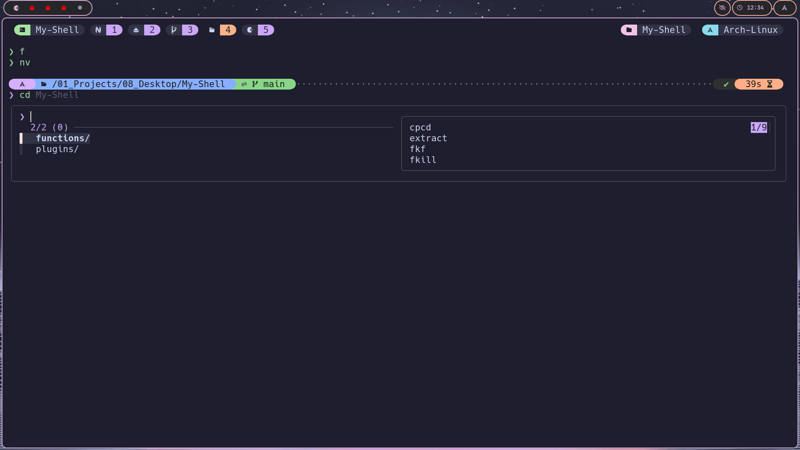

# ⚡ Fast, Modular & Aesthetic Zsh Configuration

A high-performance, modular Zsh configuration designed for sub-50ms startup times, interactive fuzzy completions via `fzf-tab`, modern CLI replacements, and a polished prompt powered by [Powerlevel10k](https://github.com/romkatv/powerlevel10k) in Catppuccin Mocha colors.

<p align="center">
  
</p>

---

## ✨ Features

- **Blazing Fast Startup (< 50ms)**:
  - **Deferred Loading**: Leverages [`zsh-defer`](https://github.com/romkatv/zsh-defer) to load heavy plugins asynchronously after prompt display.
  - **Pre-Cached Tools**: `fzf` and `zoxide` integration code is cached on disk to eliminate subshell spawn overhead on every shell launch.
  - **RAM-Cached Completions**: `.zcompdump` is stored directly in RAM (`$XDG_RUNTIME_DIR`) with 24-hour freshness checks.
  - **Automatic Bytecode Compilation**: Configuration files and functions are compiled to `.zwc` bytecode automatically in the background.
- **Interactive Completions (`fzf-tab`)**:
  - Contextual previews for directories (via `eza`), manual pages, systemd services, environment variables, and git diffs (via `delta`).
- **Safety & Ergonomics**:
  - Vi-mode support with dynamic cursor feedback (beam for insert, block for command mode).
  - Safe file deletion wrapper (`rm`) that prioritizes system trash (`trash-put`) with batch confirmation.
  - Universal archive extraction (`extract`) for all common formats.
  - Smart directory hopping (`mkcd`, `cpcd`, `mvcd`, `lfcd`).
- **Private & Local Overrides**:
  - Drop-in `.local` files allow machine-specific tokens, paths, and custom aliases without modifying tracked repository files.

---

## 📂 Architecture & Directory Layout

```
~/.config/zsh/
├── .zshenv                # Environment variables, XDG specifications, and PATH resolution
├── .zshrc                 # Main entry point: prompt, caches, modular sourcing, auto-compilation
├── options.zsh            # Shell options, history settings, RAM compinit, fzf-tab styles
├── aliases.zsh            # Global aliases, modern CLI tool wrappers, suffix rules
├── functions.zsh          # Autoloading setup and ZLE cursor shape widgets
├── plugins.zsh            # Plugin discovery and deferred loading strategy
├── p10k.zsh               # Powerlevel10k theme configuration (Catppuccin Mocha)
├── functions/             # Standalone autoloaded functions (loaded on first use)
│   ├── cpcd               # Copy and cd into destination
│   ├── extract            # Universal archive extractor
│   ├── fkf                # Interactive Flatpak installer (fzf)
│   ├── fkill              # Interactive process killer (fzf)
│   ├── lfcd               # Terminal file manager sync
│   ├── mkcd               # Make parent directories and cd into it
│   ├── mvcd               # Move and cd into destination
│   ├── pf                 # Interactive Arch package search/install (paru + fzf)
│   └── rm                 # Safe trash-first removal wrapper
└── plugins/
    └── zsh-defer/         # Vendored zsh-defer engine
```

---

## 🚀 Installation & Quick Start

### 1. Prerequisites
Install recommended CLI tools for your operating system:

#### Arch Linux:
```bash
sudo pacman -S --needed zsh fzf zoxide eza bat git-delta fd ripgrep lazygit trash-cli wl-clipboard
# Install plugins and theme
sudo pacman -S --needed zsh-autosuggestions zsh-syntax-highlighting zsh-theme-powerlevel10k
# Optional AUR packages:
paru -S fzf-tab-git yazi
```

#### macOS (Homebrew):
```bash
brew install zsh fzf zoxide eza bat git-delta fd ripgrep lazygit trash
brew install powerlevel10k zsh-autosuggestions zsh-syntax-highlighting fzf-tab yazi
```

#### Alpine Linux / Debian / Ubuntu:
Refer to [`requirements.txt`](requirements.txt) or [`DISTROBOX_ARCH_SETUP.md`](DISTROBOX_ARCH_SETUP.md).

> [!NOTE]
> Install a [Nerd Font](https://www.nerdfonts.com/) (e.g. JetBrainsMono Nerd Font) in your terminal to display prompt icons and glyphs correctly.

### 2. Clone the Repository
Clone this repository to your XDG config directory:

```bash
git clone https://github.com/SoulByte07/My-Shell.git ~/.config/zsh
```

### 3. Configure ZDOTDIR
Ensure Zsh knows where to find your configuration. Add this single line to `~/.zshenv`:

```bash
echo 'export ZDOTDIR="$HOME/.config/zsh"' >> ~/.zshenv
```

Now launch a new terminal or run `zsh`!

---

## 🛠️ Key Aliases & Functions

| Alias / Function | Command / Description |
| :--- | :--- |
| `v` | `nvim` (Neovim editor) |
| `f` | `yazi` / `lf` (Terminal file manager) |
| `l`, `la` | `eza` (Modern directory listing) |
| `ll`, `lla` | `eza -lh --git` (Detailed list with git status) |
| `lt`, `ld` | `eza --tree` (Tree view) / `eza -D` (Directories only) |
| `lg` | `lazygit` (Git TUI) |
| `cf` | Copy file contents to system clipboard |
| `zc` | `zsh-compile` (Compile config files to `.zwc` bytecode) |
| `zsh-update-cache` | Clear cached tool files, recompile, and restart Zsh |
| `mkcd <dir>` | Create directory and `cd` into it |
| `cpcd <src> <dest>` | Copy and automatically `cd` to destination directory |
| `mvcd <src> <dest>` | Move and automatically `cd` to destination directory |
| `extract <file>` | Universal archive decompression (`.tar.*`, `.zip`, `.7z`, etc.) |
| `fkill` | Interactive fuzzy process killer |
| `rm <file>` | Safe removal (moves to trash via `trash-put` when installed) |

---

## 🔒 Customizing for Your Machine (.local files)

Keep your personal paths, API tokens, and machine-specific aliases out of git:

- **`~/.config/zsh/.zshenv.local`**: Private environment variables (e.g., API keys, work paths).
- **`~/.config/zsh/.zshrc.local`**: Machine-specific startup commands.
- **`~/.config/zsh/aliases.local.zsh`**: Private or work aliases.

These files are ignored by git in [`.gitignore`](.gitignore) and will never be committed.

---

## 📜 License
MIT License. See individual plugin directories for their respective licenses.
